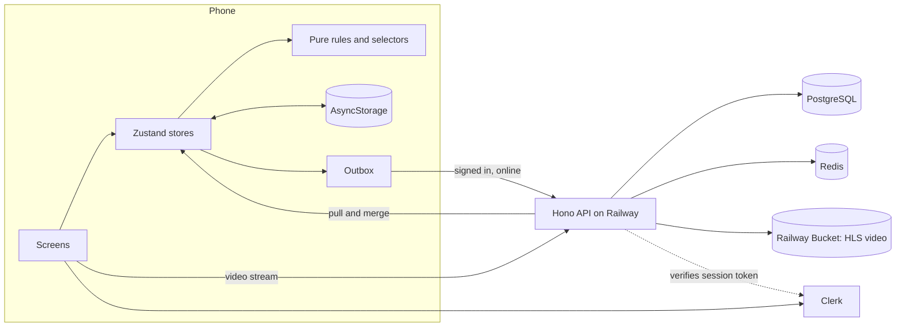

# Architecture

How OctoLearn is built, and why. For setup, see the [README](../README.md). For API and deployment reference, see [server/README.md](../server/README.md).



## Why this stack

| Decision | Chosen               | Alternative        | Why                                                                                                                                     |
| -------- | -------------------- | ------------------ | --------------------------------------------------------------------------------------------------------------------------------------- |
| App      | Expo + TypeScript    | Flutter            | One TypeScript codebase can later share types and logic with the web platform. Expo Go lets a reviewer run it without a build           |
| Routing  | Expo Router          | React Navigation   | File-based routes, typed links and deep links. It uses React Navigation underneath                                                      |
| State    | Zustand              | Redux, Context     | Small API, works outside React (the sync engine needs that), and has persistence middleware. Redux's ceremony buys nothing at this size |
| Storage  | AsyncStorage         | SQLite             | Progress is one small JSON object that's always read whole. SQLite only pays off for queries, which the phone doesn't need              |
| Video    | `expo-video` + HLS   | YouTube, plain mp4 | Adaptive quality on weak connections, full control of the player, and no third-party branding                                           |
| API      | Hono + Node          | Express, NestJS    | Small and fast, with validation and OpenAPI generated from the same Zod schemas                                                         |
| Database | PostgreSQL + Drizzle | SQLite, Prisma     | The brief prefers SQL. Postgres handles concurrent writes. Drizzle stays close to SQL and migrations are reviewable files               |
| Accounts | Clerk, optional      | Own auth           | Sign-in is a solved problem and risky to hand-roll. It's optional, so a guest can always use the app                                    |
| Hosting  | Railway              | Vercel, a VPS      | The API needs a long-running process, Postgres, Redis and a bucket. Railway has all four in one project                                 |

## Code structure

```
src/
  app/          routes only: thin files that read params, guard, render a screen
  features/     home, lesson, quiz, profile, onboarding, auth: screens and their private parts
  course/       course.json, types, the ordered learning path
  progress/     rules and selectors (pure), store
  sync/         outbox, sync engine, merge (pure, tested), API client
  settings/     theme, sound, language and reminder preferences
  notifications/ reminder planning (pure, tested), scheduling, push token
  components/   shared UI; ui/ holds the primitives
  hooks/ lib/   small reusable helpers
  i18n/         mn.ts (source) and en.ts catalogs
  theme/        tokens and theme hooks
server/         the API, with its own README
.maestro/       end-to-end flows
patches/        one expo-video patch (see Video)
```

The dependency direction is one way: `app` → `features` → `components`, `progress`, `course` → `lib`. A feature's private components stay in its folder. Something moves to `components/` only when a second feature needs it. Tests sit next to the code they test.

## State management

There are three small Zustand stores, split by lifetime rather than by screen.

| Store    | Holds                                                                             | Reset by "reset progress"?       |
| -------- | --------------------------------------------------------------------------------- | -------------------------------- |
| Progress | name, completed lessons, quiz results, XP, streak days, activity, video positions | Yes                              |
| Settings | language, theme, sound, reminders                                                 | No: these are device preferences |
| Sync     | account id, outbox queue, last sync time                                          | Cleared on sign-out              |

The rules follow three principles:

- **Stores only wire things up.** An action calls a pure function from `rules.ts` and saves the result. `completeLesson`, `recordQuizAttempt` and the rest can be tested with no React or storage.
- **Only facts are stored.** Done/active/locked status, course %, level and quiz average are selectors over saved progress. Nothing can disagree, because there is no second copy.
- **Time is a parameter.** Rules take `today`, so streaks across midnight are simple to test.

Screen-local state, such as the current quiz question, stays in the component or its hook.

## Local storage

Each store persists to its own AsyncStorage key: `octolearn.progress`, `octolearn.settings` and `octolearn.sync`.

- **Versioned.** Each key has a `version` and a `migrate` step that fills new fields with defaults, so an update can't break saved progress.
- **Partial.** `partialize` saves data only, never actions or runtime flags.
- **Restored before first paint.** The splash stays up until the stores have loaded, so a returning learner never sees an empty path.
- **Video position.** It's saved every 2 seconds while playing, so leaving a lesson keeps both the resume point and the progress toward 90%.

Clerk's session token is the one secret on the phone. It lives in `expo-secure-store`, not AsyncStorage.

## Sync

The phone stays the source of truth for the UI, so nothing waits for the network. Guests never touch the API.

1. **Queue.** While signed in, each change also goes into the persisted outbox: lessons, quiz attempts, video positions and profile edits.
2. **Send.** The engine sends in order when the app is online, returns to the foreground, or something changes. It retries with backoff and jitter. A change the server rejects for good is dropped, so it can't block the rest.
3. **No double counting.** Each quiz attempt carries an `Idempotency-Key`, so resending after a lost response replays the first result. Lesson completion is naturally idempotent.
4. **Pull.** Once the outbox is empty, the engine pulls the account and merges it. The server wins for XP, streak and quiz results; local items it hasn't received yet are kept.
5. **First sign-in.** Guest progress is replayed in learning-path order.
6. **Sign-out.** This clears the phone. Signing in on any phone brings progress back.

## Video

- Lessons are transcoded to adaptive HLS with `server/scripts/transcode-hls.sh` and stored in a Railway Bucket. The API streams them at `/media/videos/...` with cache headers.
- `expo-video` plays them behind custom controls: seek, double-tap skip, speed, quality and fullscreen.
- The controls are custom so they look the same on both platforms, and so playback can feed the 90% rule.
- A failed video shows an error with retry, and retries by itself when the connection returns.
- `patches/expo-video@58.0.13.patch` switches iOS to the `.timeDomain` pitch algorithm, because the default made speech sound robotic at 1.25×–2×. Patches only apply to native builds, so Expo Go keeps the default.

## Backend

Each feature is a folder under `server/src/modules`, split into `*.routes.ts` and `*.service.ts`, with schemas and pure rules beside them. Zod schemas validate requests and generate the [OpenAPI reference](https://api-production-bed0e.up.railway.app/docs), so the docs can't drift from the code.

**Database** (`server/src/db/schema`):

| Group    | Tables                                                                                   |
| -------- | ---------------------------------------------------------------------------------------- |
| Content  | `courses`, `units`, `lessons`, `quizzes`, `quiz_questions`                               |
| Accounts | `users`                                                                                  |
| Progress | `lesson_completions`, `quiz_attempts`, `video_progress`, `xp_events`, `idempotency_keys` |

XP is an append-only event table, so totals, weekly leaderboards and audits all come from one record.

**Trust:** the client is never trusted for scoring. The server grades quiz answers and re-checks the unlock order. Clerk session tokens are verified on every signed-in request.

**Redis** caches course reads and backs rate limiting. It's optional at runtime: if Redis goes down, the API keeps serving from Postgres, and `/health/ready` reflects that.

## Deployment

**API on Railway:** one project with the `api` service, Postgres, Redis and a bucket. Each deploy:

1. Builds the `Dockerfile` into a small non-root Node 24 image.
2. Runs migrations and the seed before the new version starts. Both are idempotent.
3. Waits for `/health/ready` before moving traffic.
4. Sends SIGTERM to the old version, which drains for 15 seconds.

Secrets live in Railway variables and are validated at startup. Only public values are in the repo.

**App on EAS:** the `preview` profile builds the APK and the iOS Simulator app. EAS Update can ship JavaScript fixes to installed builds on the `preview` channel, so a small fix doesn't need a new APK.

## Testing

| Layer         | Tool                  | Covers                                                                         |
| ------------- | --------------------- | ------------------------------------------------------------------------------ |
| App logic     | `bun test`, 134 tests | rules, selectors, sync, merge, reminders, i18n parity, course data             |
| App flows     | Maestro, 7 flows      | onboarding, both units, rewatch, profile and settings, not-found, account sync |
| API logic     | Vitest, 58 unit tests | streaks across time zones, grading, the unlock path, config, errors            |
| API over HTTP | Vitest, 13 e2e files  | auth, idempotency, races, caching, resilience, against real Postgres and Redis |

## Known trade-offs

- **Seeking counts toward the 90% rule.** That's convenient here, but too lenient for a paid course.
- **Bundled content** means a content change needs an app update until the app fetches the course from the API.
- **Video goes through the API.** It's streamed through the API and Railway's CDN. A real launch at scale should move it to a dedicated video service.
